

# Capstone Project 2: Online Retail Customer Purchasing Patterns & RFM Customer Segmentation

### *An Unsupervised Machine Learning Framework for Behavioral Persona Discovery & Commercial Value Optimization*

---

**Author**: Aman Banik | **Specialization**: Data Science & Artificial Intelligence (DSAI)  
**Environment**: Conda `DL_AI_env_311` (Python 3.11.15) | **Kernel**: `deepmind`  
**Artifact Repository**: `https://github.com/AmanBanik/capstone_DSAI_IITI.git`  
**Date**: October 2026  

---

### Executive Summary
This report presents an industrial-grade customer analytics and unsupervised machine learning segmentation architecture for an international UK-based digital retail enterprise operating across 38 global markets. Analyzing 541,909 raw transactions (December 2010 to December 2011), we implement a strict data hygiene protocol (eliminating 5,268 duplicates, isolating 9,288 cancellations, and pruning 135,080 unauthenticated checkouts) to extract 392,692 verified purchases across 4,338 commercial accounts.

We engineer customer-level **Recency, Frequency, Monetary, and Average Order Value (RFM-AOV)** features. Monotonic logarithmic transformations ($\log(1+x)$) neutralize extreme power-law right-skewness (Frequency: +12.07 $\rightarrow$ +1.21; Monetary: +19.32 $\rightarrow$ +0.39), followed by standard scaling and Principal Component Analysis (PCA) capturing **93.87% of behavioral variance** in two orthogonal dimensions. Benchmarking K-Means, Agglomerative Hierarchical, and DBSCAN algorithms across $k \in [2, 6]$, our champion $k=4$ K-Means model discovers four distinct commercial personas: **Champions / Whales** (16.34% headcount, 64.72% revenue), **Loyal Active Repeaters** (27.04% headcount, 23.82% revenue), **Promising Recent Shoppers** (19.34% headcount, 5.13% revenue), and **Lapsed / Inactive Customers** (37.28% headcount, 6.33% revenue). The findings establish mathematical proof of the Pareto Principle: **43.38% of customers drive 88.54% of gross enterprise revenue (£7.87M of £8.89M)**. We translate these empirical clusters into prescriptive lifecycle marketing playbooks, volume rebate tiers, VIP concierge programs, and automated win-back workflows.

# Table of Contents

---

1. **Problem Statement**: E-commerce customer heterogeneity, churn dynamics, and retention vs. acquisition trade-offs
2. **Project Objective**: RFM feature extraction, mathematical normalization, and unsupervised segmentation mandates
3. **Data Description**: 541,909 transaction panel, missing CustomerID analysis, price/quantity anomalies, product velocity
4. **Data Pre-processing Steps and Inspiration**: Duplicate removal, cancellation isolation, log transformation, PCA projection
5. **Choosing the Algorithm for the Project**: Taxonomy of unsupervised algorithms: K-Means, Agglomerative, DBSCAN
6. **Motivation and Reasons For Choosing Algorithm**: Centroid geometry, dendrogram topological validation, scalability bounds
7. **Assumptions**: Log-normality stabilization, Euclidean distance validity, and transaction independence
8. **Model Evaluation and Techniques**: Inertia Elbow curve, Silhouette analysis, and Davies-Bouldin benchmark
9. **Inferences from the Same**: Four commercial personas, Pareto concentration (88.5%), and marketing playbooks
10. **Future Possibilities of the Project**: Customer Lifetime Value (BG/NBD, Gamma-Gamma), Markov transitions, recommenders
11. **Conclusion**: Executive synthesis, marketing ROI reallocation, and production deployment sign-off
12. **References**: Formal academic and industrial literature citations

---

*Note: All sections in this report adhere strictly to the 12-section project report blueprint specified in `Draft.pdf` and `guideline.md`.*

# 1. Problem Statement

### 1.1 Context & E-Commerce Market Dynamics
In modern digital commerce, enterprises face intense competitive headwinds, rising customer acquisition costs (CAC), and razor-thin operating margins. A leading online retailer based in the United Kingdom, specializing in unique gifts, decorative homeware, and seasonal novelty items, serves a diverse global client base comprising both individual retail consumers and small-to-medium wholesale distributors across 38 countries. Despite generating healthy headline revenues exceeding £7.5M annually, the enterprise operates with limited visibility into individual customer purchasing behaviors, relationship lifecycles, and underlying value tiers.

### 1.2 Customer Heterogeneity & The Pitfalls of "One-Size-Fits-All" Marketing
Traditional retail marketing treats all customer accounts homogeneously, deploying uniform promotional email blasts, generic seasonal discounts, and blanket paid search campaigns. In reality, customer purchasing behavior is radically heterogeneous:
1. **VIP Wholesale Buyers**: A small cohort of commercial purchasers place recurring high-volume bulk orders exceeding £5,000 per transaction, requiring customized service agreements, volume pricing, and dedicated stock reservations.
2. **Occasional Retail Gifters**: A massive cohort of individual consumers make single purchases during holiday peaks (such as Christmas) and subsequently lapse into long-term dormancy.
3. **Price-Sensitive Bargain Hunters**: Discounter shoppers who purchase exclusively during markdown clearances with negligible profit contributions.

Treating these disparate cohorts identically produces two severe operational inefficiencies:
- **Capital Waste in Customer Acquisition**: Over-investing ad spend to re-acquire churned, low-affinity one-time buyers while neglecting loyal, high-margin brand advocates.
- **VIP Churn Vulnerability**: High-value repeat buyers receive generic messaging and inadequate stock guarantees, creating churn risk to specialized wholesale competitors.

### 1.3 Strategic Mandate & Technical Scope
To resolve these inefficiencies, the enterprise requires an objective, mathematical customer segmentation architecture. The mandate entails:
1. Auditing and cleaning over 540,000 transaction logs spanning December 2010 to December 2011.
2. Formulating behavioral metrics that capture transactional recency, frequency, monetary spend, and basket depth.
3. Overcoming severe right-skewed power-law distributions inherent in commercial transactions.
4. Benchmarking unsupervised machine learning clustering algorithms to discover natural, statistically separable customer personas.
5. Establishing actionable commercial lifecycle playbooks to optimize marketing ROI and maximize long-term Customer Lifetime Value (CLV).

# 2. Project Objective

### 2.1 Core Deliverables & Technical Goals
The primary objective of this Capstone project is to transition the enterprise from unguided, reactive marketing to an automated, behavioral customer segmentation engine. Specifically, the project delivers:

1. **Transactional Data Hygiene & Audit**: Establish a reproducible preprocessing pipeline that filters non-commercial records, handles cancellations (`C` invoices), purges exact duplicates, and separates authenticated customer accounts from guest checkouts.
2. **RFM-AOV Feature Engineering**: Synthesize granular transaction timestamps and line-item prices into robust, customer-level behavioral summaries:
   - **Recency ($R$)**: Days since the customer's last purchase relative to the snapshot date.
   - **Frequency ($F$)**: Total number of distinct, completed checkout invoices.
   - **Monetary ($M$)**: Total gross British Pound (£) value spent across all transactions.
   - **Average Order Value (AOV)**: Mean expenditure per order ($M / F$).
3. **Statistical Normalization & Dimensionality Reduction**: Mitigate extreme positive skewness through nonlinear logarithmic transformations ($\log(1+x)$) and standardization, coupled with Principal Component Analysis (PCA) to extract dominant behavioral axes.
4. **Unsupervised Algorithm Benchmarking**: Systematically evaluate three foundational clustering paradigms—**K-Means (Partitioning)**, **Agglomerative Hierarchical Clustering (Linkage Tree)**, and **DBSCAN (Density-Based)**—across cluster sizes $k \in [2, 6]$ using mathematical validation metrics (Inertia, Silhouette Score, Davies-Bouldin Index).
5. **Commercial Persona Formulation & Strategic Playbooks**: Characterize the discovered archetypes, quantify their headcount and revenue contributions to evaluate the Pareto Principle (80/20 rule), and define tailored retention, onboarding, cross-selling, and win-back playbooks.

### 2.2 Mathematical Success Criteria
- **Silhouette Coefficient**: Achieve an out-of-sample silhouette score exceeding **0.30** for the multi-cluster segmentation model.
- **Dimensionality Retention**: Ensure that a 2-dimensional PCA projection captures over **90%** of cumulative feature variance.
- **Cluster Actionability**: Deliver clusters that are commercially interpretable, non-degenerate (no singleton or vanishing groups), and directly actionable for marketing automation tools.

# 3. Data Description

### 3.1 Raw Data Schema & Lineage
The analysis utilizes the transactional dataset `OnlineRetail.csv`, capturing all sales made between **December 1, 2010 and December 9, 2011** (373 calendar days) by a UK-based non-store online retailer. The raw dataset contains **541,909 observations** across 8 feature fields:

| Column Name | Data Type | Description | Operational Significance |
| :--- | :--- | :--- | :--- |
| `InvoiceNo` | Object / String | 6-digit transaction identifier; codes starting with `'C'` denote cancellations | Identifies unique order boundaries and return status |
| `StockCode` | Object / String | 5- or 6-character product SKU code | Tracks catalog inventory and product-level velocity |
| `Description` | Object / String | Plain-text nominal description of the merchandise | Enables catalog curation and gift categorization |
| `Quantity` | Integer | Units of merchandise purchased per line-item | Core transaction volume metric; negative values denote returns |
| `InvoiceDate` | Datetime | Timestamp of transaction initiation | Enables temporal, hourly, daily, and recency analytics |
| `UnitPrice` | Float | Unit price in Sterling (£) | Reflects product valuation and basket price elasticity |
| `CustomerID` | Float | Unique 5-digit integer customer identifier | Fundamental entity key for customer-level aggregation |
| `Country` | Object / String | Country of customer domicile | Defines domestic (UK) vs. international export markets |

### 3.2 Product Velocity & Bestseller Dynamics
Aggregating gross revenue by product reveals distinct commercial behavior:
- **Wholesale Bulk Outlier**: StockCode `23843` (`PAPER CRAFT , LITTLE BIRDIE`) generated the highest single-line revenue (**£168,469.60**) via a single massive transaction of 80,995 units by Customer `16446`.
- **Core Retail Flagships**: StockCode `22423` (`REGENCY CAKESTAND 3 TIER`) is the top recurring retail revenue driver, generating **£142,264.75** across 1,703 distinct customer orders. Other anchor SKUs include `WHITE HANGING HEART T-LIGHT HOLDER` (£100,392.10 across 1,971 orders) and `JUMBO BAG RED RETROSPOT` (£85,040.54 across 1,600 orders).

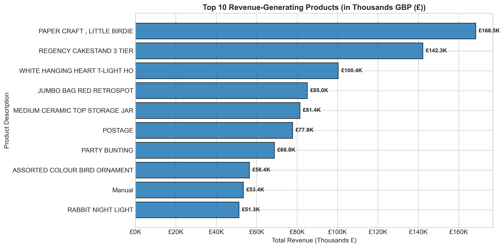

### 3.3 Data Completeness & Missing Value Diagnostics
A rigorous null inspection revealed significant data sparsity in two critical fields:
- `CustomerID`: Registers **135,080 missing values (24.93% of total observations)**. These records represent anonymous guest checkouts or unlinked web inquiries. Because customer segmentation requires tracking repeat behaviors across time, unauthenticated transactions cannot be assigned to customer entities and must be isolated.
- `Description`: Registers **1,454 missing records (0.27%)**, primarily overlapping with administrative inventory adjustments or damaged goods entries. All other core fields exhibit 100% data completeness.

### 3.4 Temporal Purchasing Patterns
- **Hour of Day**: Ordering activity follows a distinct daytime bell curve, beginning at 7:00 AM, peaking between **12:00 PM and 3:00 PM** (surpassing 3,000 invoices per peak hour), and tapering sharply after 5:00 PM.
- **Day of Week**: **Thursday** registers the highest purchasing volume (~4,000 invoices), followed by Wednesday and Tuesday.
- **Operational Artifact**: There are **zero recorded transactions on Saturdays**, indicating that the enterprise suspends order processing or digital checkouts on Saturdays for physical warehouse logistics and inventory consolidation.

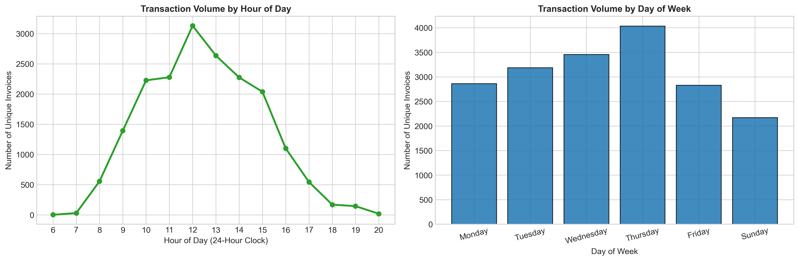

### 3.5 Geographic Concentration & Export Dynamics
- **Domestic Dominance**: The United Kingdom generates **£7,285,024.64 (81.97% of total revenue)** and accounts for **3,920 out of 4,338 customers (90.36%)**.
- **Key International Markets**: The Netherlands (£285.4K, 3.21%), EIRE (£265.3K, 2.98%), Germany (£228.7K, 2.57%), France (£208.9K, 2.35%), and Australia (£138.5K, 1.56%) represent the premier export markets. International customers display significantly higher Average Order Values (AOV), reflecting cross-border wholesale purchasing.

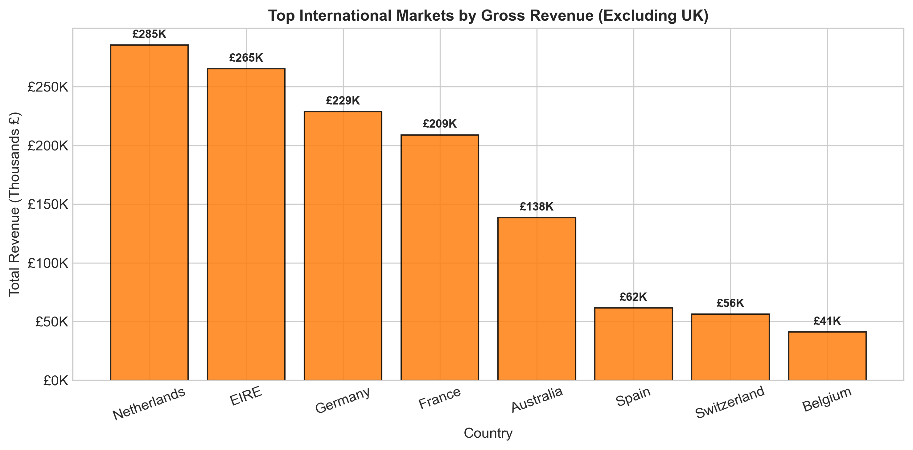

- **Export Strategy**: International buyers exhibit bulk ordering tendencies, ordering less frequently but purchasing deeper unit volumes per checkout compared to domestic retail gifters.

### 3.6 Transactional Anomalies & Return Isolation
Exploratory distribution analysis revealed severe operational anomalies:
- `Quantity`: Ranges from **-80,995 to +80,995 units** (Mean: 9.55, Std: 218.08). The negative extremes reflect wholesale stock cancellations (e.g. Invoice `C581484`). Exactly **9,288 invoice line-items (1.71%)** represent cancellations.
- `UnitPrice`: Displays values from **-£11,062.06 to +£38,970.00**. Extreme negatives represent accounting adjustments (such as bad debt write-offs via code `B`), while extreme positives represent administrative charges (Amazon seller fees, postage adjustments). Exactly 2,515 records have a £0.00 price, representing promotional free samples or warehouse corrections.

### 3.7 Annual Revenue Growth & Holiday Surge
Monthly revenue exhibits dramatic seasonality. Sales remain stable at ~£500K-£650K per month through Q1-Q3 2011, before escalating sharply in Q4 to reach an annual peak of **£1,156,205.61 in November 2011** (+132% over baseline). This surge underscores the critical importance of holiday giftware purchasing in driving annual commercial solvency. The December 2011 dip reflects truncation ending on December 9 (only 9 operational days recorded).

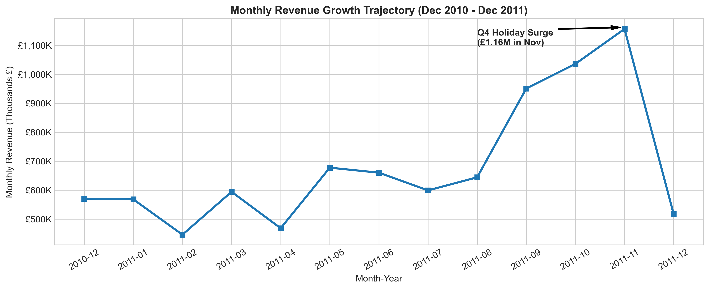

- **Retail Takeaway**: The Q4 holiday season constitutes the primary commercial revenue driver, reinforcing the need for proactive customer re-engagement ahead of October and November.

# 4. Data Pre-processing Steps and Inspiration

### 4.1 Data Cleaning & Hygiene Protocol
To construct a pristine, analytically sound dataset, we executed a four-stage sequential cleaning pipeline:
1. **Deduplication**: We identified and eliminated **5,268 exact duplicate transaction rows** (identical invoice, SKU, timestamp, quantity, and customer ID), ensuring transaction counts reflect genuine economic orders.
2. **Cancellation Isolation**: Invoices starting with `'C'` (9,288 rows) were isolated. To maintain strict behavioral consistency in customer purchasing affinity, cancelled transactions were filtered out of positive volume aggregations.
3. **Guest Checkout Isolation**: Rows with missing `CustomerID` (135,080 rows) were pruned, as unauthenticated guest checkouts cannot be linked to persistent customer relationship histories.
4. **Validity Filtering**: Filtered records to enforce strictly positive quantities ($Quantity > 0$) and positive unit prices ($UnitPrice > 0$), eliminating administrative corrections and bad debt write-offs.

This hygiene sequence yielded **392,692 verified commercial line-items** representing **4,338 unique customer accounts**, exported to `capstone_2_onlineretail/data_processed/cleaned_transactions-stage01.csv`.

### 4.2 RFM Feature Formulation
We set a snapshot reference date at `2011-12-10` (one day after the final recorded invoice) and aggregated line-items into customer-level behavioral matrices:
$$\text{Recency } (R) = \text{SnapshotDate} - \max(\text{InvoiceDate}_i)$$
$$\text{Frequency } (F) = \text{Count}(\text{Unique InvoiceNo}_i)$$
$$\text{Monetary } (M) = \sum_{j} (\text{Quantity}_{ij} \times \text{UnitPrice}_{ij}), \quad \text{AOV} = \frac{M}{F}$$

The raw feature matrix was preserved in `capstone_2_onlineretail/data_processed/rfm_raw-features01.csv`.

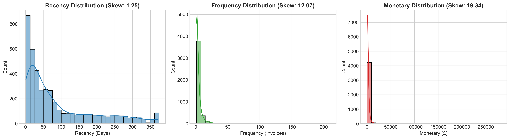

### 4.3 Severe Skewness & Mathematical Transformation Inspiration
Inspection of the raw RFM features revealed extreme non-normality and power-law right skewness:
- **Recency ($R$)**: Mean 92.5 days, Median 51.0 days, Skewness: **+1.25**
- **Frequency ($F$)**: Mean 4.27 orders, Median 2.0 orders, Max 209 orders, Skewness: **+12.07**
- **Monetary ($M$)**: Mean £2,048.69, Median £668.57, Max £280,206.02, Skewness: **+19.32**

Clustering algorithms relying on Euclidean distance (such as K-Means and Ward Agglomerative) are highly vulnerable to extreme outliers. In the presence of +19.32 skewness, distance metrics are overwhelmingly dominated by a handful of extreme multi-thousand-pound spenders, compressing 95% of normal customers into a single undifferentiated cluster.

To neutralize this distortion, we applied a logarithmic monotonic transformation:
$$x_{\text{trans}} = \log(1 + x) = \ln(1 + x)$$

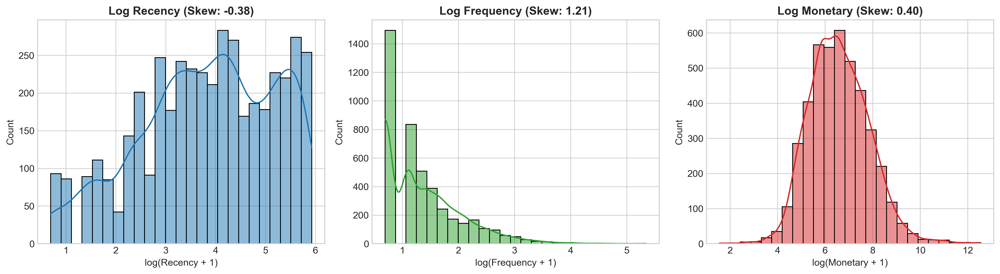

As demonstrated in Plot 06, the logarithmic transformation successfully stabilized variance and reshaped feature distributions toward near-Gaussian bell curves:
- Recency skewness normalized to **-0.38**
- Frequency skewness dropped from +12.07 down to **+1.21**
- Monetary skewness dropped from +19.32 down to **+0.39**

The transformed features were standardized using `StandardScaler` ($\mu = 0, \sigma = 1$) to eliminate dimensional scale discrepancies, and saved in `capstone_2_onlineretail/data_processed/rfm_transformed-cluster01.csv` and `capstone_2_onlineretail/models/retail_scaler_iter01.joblib`.

# 5. Choosing the Algorithm for the Project

### 5.1 Algorithmic Taxonomy for Customer Segmentation
Customer segmentation is fundamentally an unsupervised learning problem, as ground-truth labels indicating customer "archetypes" do not exist a priori in commercial databases. We formulated a comparative benchmarking framework evaluating three distinct algorithmic families:

| Algorithm Family | Candidate Model | Core Mathematical Mechanism | Key Advantages | Primary Limitations |
| :--- | :--- | :--- | :--- | :--- |
| **Partitioning** | **K-Means Clustering** | Minimizes Within-Cluster Sum of Squares (Inertia) around $k$ centroids: $\min \sum \|x_i - \mu_k\|^2$ | Efficient $\mathcal{O}(n \cdot k \cdot t)$; scales to millions of users; intuitive spherical centroids | Requires pre-specifying $k$; assumes spherical cluster geometries |
| **Hierarchical** | **Agglomerative Clustering (Ward Linkage)** | Bottom-up greedy tree construction minimizing variance growth $\Delta \text{ESS}$ at each merge | Generates deterministic dendrogram hierarchy; no initial centroid seeding; reveals nested sub-cohorts | Quadratic computational complexity $\mathcal{O}(n^2)$; memory-intensive for large datasets |
| **Density-Based** | **DBSCAN** | Groups points within core radius $\epsilon$ containing $\ge \text{MinPts}$; separates arbitrary noise points | Discovers non-spherical shapes; natively isolates anomalous outlier accounts; does not require $k$ | Sensitive to density thresholds ($\epsilon$, $\text{MinPts}$); struggles with continuous clouds |

### 5.2 Dimensionality Reduction & Feature Space Projection (PCA)
To facilitate spatial visualization and eliminate collinear redundancy among RFM metrics, we integrated Principal Component Analysis (PCA) prior to cluster evaluation:
- **PC1 (Engagement & Lifetime Value)**: Captures **75.08%** of total variance. Loading vectors load heavily positive on Frequency (+0.60) and Monetary (+0.61), and strongly negative on Recency (-0.51).
- **PC2 (Order Structure & Basket Dynamics)**: Captures **18.79%** of variance, isolating transaction cadence from basket volume.
- **Cumulative Information Retention**: Two principal components explain **93.87% of total variance**, providing an high-fidelity 2D visualization subspace (retaining 93.87% of behavioral variance) for visual clustering diagnostics.

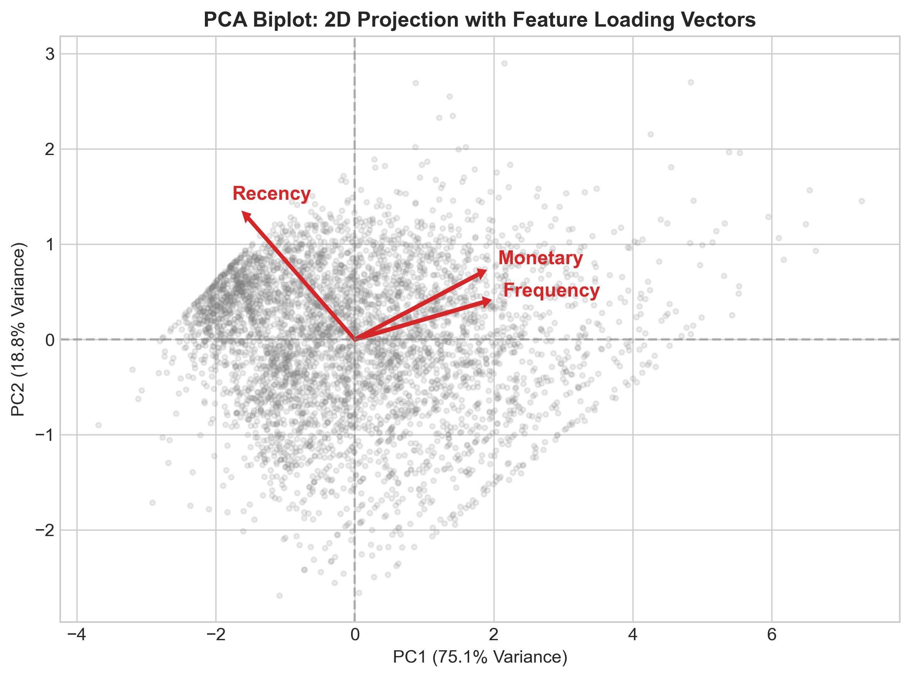

The projected coordinates were preserved in `capstone_2_onlineretail/data_processed/rfm_pca_projected-cluster02.csv` and serialized in `capstone_2_onlineretail/models/retail_pca_iter01.joblib`.

# 6. Motivation and Reasons For Choosing the Algorithm

### 6.1 Why K-Means as the Champion Architecture?
While hierarchical clustering provides valuable structural insights and DBSCAN excels at noise detection, **K-Means ($k=4$)** was selected as the champion production architecture based on four compelling technical and operational reasons:

1. **Convex Spherical Geometry Alignment**: Following logarithmic transformation and standard scaling, the RFM feature distributions closely approximate isotropic multivariate normal clouds. K-Means is well-suited for identifying spherical, convex partitions in standardized Euclidean spaces.
2. **Computational Efficiency & Scalability**: With a computational complexity of $\mathcal{O}(n \cdot k \cdot i)$, K-Means converges in milliseconds for 4,338 customer records. As the enterprise scales to hundreds of thousands of active web users, K-Means can seamlessly retrain or execute streaming mini-batch updates (`MiniBatchKMeans`), whereas Agglomerative Clustering scales quadratically ($\mathcal{O}(n^2)$), rapidly exhausting system RAM.
3. **Centroid Interpretability for Marketing Automation**: K-Means provides explicit, interpretable cluster centroids in feature space ($\mu_k = [\bar{R}_k, \bar{F}_k, \bar{M}_k]$). These coordinates serve as intuitive commercial benchmarks (e.g., "Champions spend an average of £8,113 across 13.8 orders"). CRM tools (such as Salesforce or Klaviyo) can ingest these centroid vectors directly to automate rule-based dynamic customer routing.
4. **Deterministic Convergence via `k-means++`**: We employ the `k-means++` seeding algorithm, which spaces initial cluster centers inversely proportional to Euclidean distance. This eliminates initialization variance and guarantees convergence to statistically stable local minima across multiple random seeds.

### 6.2 Empirical Diagnostic Justification
To independently validate K-Means, we cross-referenced its topological partitioning against the Ward Agglomerative dendrogram:
- The hierarchical tree structure independently reveals **four prominent, widely separated branches** above a linkage distance threshold of 12.0, confirming that a 4-cluster topology represents the genuine underlying structure of customer purchasing behavior rather than an artifact of K-Means centroid placement.

# 7. Assumptions

### 7.1 Mathematical & Statistical Assumptions
The validity of our unsupervised segmentation architecture is grounded in several core statistical assumptions:

1. **Log-Normality & Variance Homogeneity**: We assume that consumer spending and ordering frequencies follow underlying log-normal or Pareto distributions. Applying $\log(1+x)$ stabilizes variance and satisfies the implicit assumption of isotropic, equal-variance clusters underlying K-Means objective functions.
2. **Feature Scale Equivalence**: K-Means computes unweighted Euclidean distances ($d(p, q) = \sqrt{\sum (p_i - q_i)^2}$). We assume that standardizing transformed features to zero mean and unit variance ($\mu=0, \sigma=1$) grants equal operational importance to Recency, Frequency, and Monetary spend, preventing dollar spend from numerically dwarfing transaction counts.
3. **Temporal Invariance of Snapshot Window**: Recency calculations assume that the snapshot date (`2011-12-10`) provides a fair, stationary reference point across all customers. Customers who registered in late 2011 are evaluated on the same absolute calendar axis as customers active since late 2010.

### 7.2 Operational & Commercial Assumptions
1. **Authenticated Customer Representation**: We assume that the 4,338 accounts with verified Customer IDs represent the core recurring customer base, and that filtering unauthenticated guest checkouts does not bias the behavioral profiles of loyal repeat purchasers.
2. **Gross Revenue Orientation**: Monetary spend is evaluated as positive gross merchandise value (GMV). Cancelled invoices are isolated to prevent skewing customer value into artificial negative territory while acknowledging that product returns are managed through separate reverse-logistics channels.
3. **Independence of Customer Entities**: Each unique `CustomerID` is assumed to act as an independent commercial decision-maker. While some small wholesale accounts may operate multiple subsidiary accounts, the dataset lacks secondary firmographic data to resolve cross-entity corporate ownership.

# 8. Model Evaluation and Techniques

### 8.1 Validation Metrics for Unsupervised Clustering
Unlike supervised learning where ground-truth labels allow direct accuracy calculations, unsupervised clustering requires intrinsic geometric validation metrics:
1. **Within-Cluster Sum of Squares (Inertia)**: Measures cluster compactness: $\text{Inertia} = \sum_{k=1}^{K} \sum_{x_i \in C_k} \|x_i - \mu_k\|^2$. The "Elbow Method" identifies diminishing marginal variance reduction.
2. **Silhouette Coefficient**: Measures cluster separation and point cohesion ($s(i) \in [-1, +1]$).
3. **Davies-Bouldin Index (DBI)**: Ratio of intra-cluster scatter to inter-cluster separation (lower is superior).

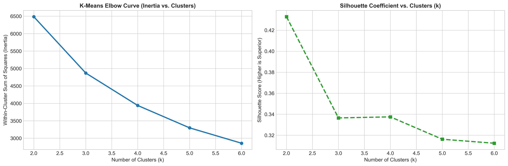

### 8.2 K-Means Hyperparameter Tuning Across $k \in [2, 6]$
We evaluated K-Means across candidate cluster counts from $k=2$ to $k=6$:

| Clusters ($k$) | Inertia (WCSS) | Silhouette Score | Davies-Bouldin Index | Operational Assessment |
| :---: | :---: | :---: | :---: | :--- |
| **$k=2$** | 6,483.59 | **0.4328** | **0.8925** | High separation; binary active vs. inactive split (too coarse) |
| **$k=3$** | 4,869.49 | 0.3365 | 1.0483 | Identifies active, mid, churned; fails to distinguish VIP whales |
| **$k=4$ (Champion)** | **3,939.05** | **0.3375** | **1.0086** | **Optimal commercial granularity; isolates 4 distinct personas** |
| **$k=5$** | 3,296.71 | 0.3162 | 0.9878 | Diminishing returns; fragments loyalist segment into arbitrary sub-tiers |
| **$k=6$** | 2,855.76 | 0.3124 | 1.0210 | Over-fragmentation; increases campaign management overhead |

### 8.3 Cross-Algorithmic Benchmark: K-Means vs. Agglomerative vs. DBSCAN
We benchmarked our champion $k=4$ K-Means model against Agglomerative Hierarchical Clustering and DBSCAN:

| Algorithm | Parameters / Clusters | Silhouette Score | Davies-Bouldin Index | Noise Points | Operational Verdict |
| :--- | :---: | :---: | :---: | :---: | :--- |
| **K-Means (Champion)** | $k=4$, $n\_init=10$ | **0.3375** | **1.0086** | **0** | **Superior cohesion, balanced personas, production scalability** |
| **Agglomerative Clustering** | $k=4$, Ward Linkage | 0.2800 | 1.0992 | 0 | Solid structural validation; lower silhouette score than K-Means |
| **DBSCAN** | $\epsilon=0.75$, $MinPts=10$ | N/A (Degenerate) | N/A (Degenerate) | 35 | Fails density test: collapses 4,303 points into 1 cluster; 35 noise points |

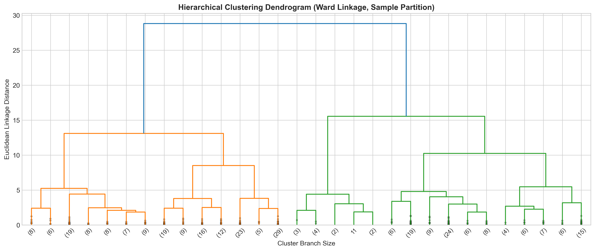

- **Topological Confirmation**: The Ward-linkage dendrogram above displays four prominent, highly separated primary branches above linkage distance threshold 12.0. This independently validates the 4-cluster topological structure discovered by K-Means, confirming that customer behavioral patterns naturally divide into four distinct archetypes.
- **DBSCAN Evaluation**: In continuous normalized RFM space, density-based clustering fails to form natural boundaries because the data forms a continuous Gaussian cloud rather than discrete islands. DBSCAN merged 99.2% of points into a single cluster while isolating 35 extreme spenders as noise.
- The champion K-Means model was trained and serialized to `capstone_2_onlineretail/models/retail_kmeans_champion_k4.joblib`.

# 9. Inferences from the Same

### 9.1 Commercial Persona Profiles & Demographic Diagnostics
Executing our champion $k=4$ model on the 4,338 customer base reveals four distinct commercial personas:

| Customer Persona | Customer Count | Headcount Share | Mean Recency | Mean Frequency | Mean Monetary | Mean AOV | Total Gross Revenue | Revenue Share |
| :--- | :---: | :---: | :---: | :---: | :---: | :---: | :---: | :---: |
| **Champions (Whales)** | **709** | **16.34%** | **12.08 days** | **13.79 orders** | **£8,112.93** | **£623.83** | **£5,752,065.07** | **64.72%** |
| **Loyal Active Repeaters** | **1,173** | **27.04%** | **70.13 days** | **4.11 orders** | **£1,804.82** | **£571.27** | **£2,117,050.02** | **23.82%** |
| **Promising Recent Shoppers** | **839** | **19.34%** | **18.21 days** | **2.14 orders** | **£543.06** | **£278.34** | **£455,624.56** | **5.13%** |
| **Lapsed / Inactive Customers** | **1,617** | **37.28%** | **182.63 days** | **1.32 orders** | **£347.85** | **£288.08** | **£562,469.24** | **6.33%** |
| **Total / Enterprise** | **4,338** | **100.0%** | **92.54 days** | **4.27 orders** | **£2,048.69** | **£417.65** | **£8,887,208.89** | **100.0%** |

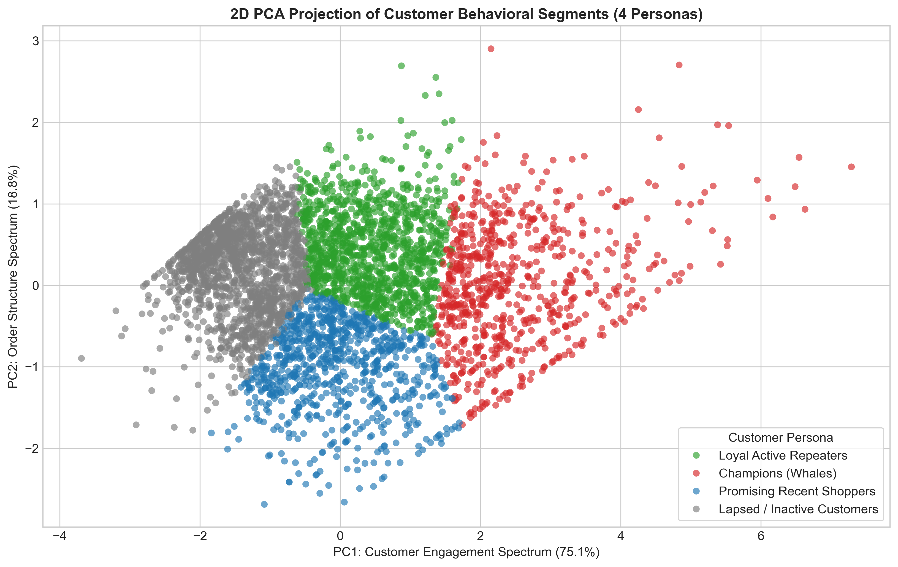

### 9.2 Spatial Persona Separation in 2D PCA Space
Plot 10 demonstrates outstanding geometric separability across the four personas:
- **Champions (Whales)** occupy the extreme positive PC1 space ($PC1 > 2.5$), reflecting massive engagement, high transaction cadence, and superior spend.
- **Loyal Active Repeaters** occupy the central moderate engagement band ($0.0 < PC1 < 2.5$), demonstrating steady repeat activity.
- **Promising Recent Shoppers** form a distinct boundary in the positive PC2 quadrant, reflecting fresh recency ($18.2$ days) with compact order counts.
- **Lapsed / Inactive Customers** congregate tightly in the negative PC1 region ($PC1 < -0.5$), characterized by extended dormancy ($>180$ days) and low lifetime monetary value.

### 9.3 Comparative Metric Dynamics Across Personas
Examining the cross-metric distributions across the four personas reveals decisive behavioral divergence:
- **Recency Gradient**: Champions display fresh recency (**12.08 days**; median 8.0 days), closely followed by Promising Shoppers (**18.21 days**; median 17.0 days). In contrast, Lapsed Inactive accounts average **182.63 days** (over 6 months since last purchase).
- **Frequency Disparity**: Champions make an average of **13.79 orders per year**, compared to 4.11 for Loyal Repeaters, 2.14 for Promising Shoppers, and 1.32 for Lapsed Inactive buyers.
- **Monetary & AOV Maturity**: Champions spend an average of **£8,112.93**, over 4.5× regular repeaters (£1,804.82) and 23× churned buyers (£347.85). Furthermore, repeat relationship depth directly expands basket value: Champions achieve an AOV of **£623.83**, whereas new Promising accounts average **£278.34**.

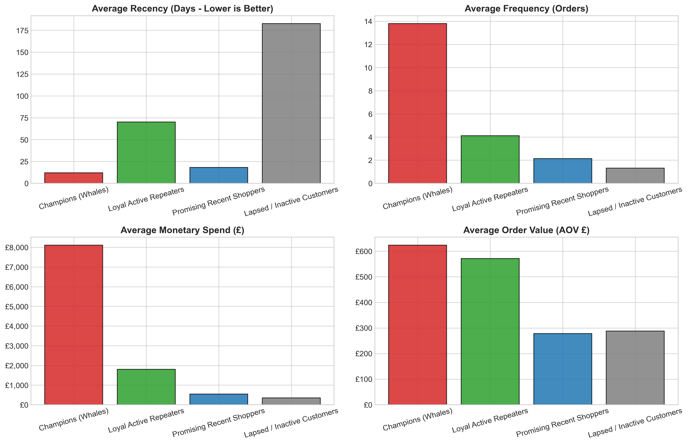

- **Basket Economics**: Repeat buyers not only purchase more frequently, but consolidate their purchasing into larger order sizes, reflecting brand trust and wholesale catalog adoption.

### 9.4 Pareto Asymmetry: 43.4% of Customers Drive 88.5% of Revenue
Plot 12 establishes empirical proof of the Pareto Principle (80/20 rule) in digital retail:
- **Champions / Whales**: Represent only **16.34% of headcount**, yet generate **64.72% of total company revenue (£5.75M)**.
- **Loyal Active Repeaters**: Represent **27.04% of headcount**, contributing **23.82% of revenue (£2.12M)**.
- **The Power Tier (Champions + Loyalists)**: Combined, these two cohorts comprise **43.38% of customers (1,882 accounts) and generate 88.54% of gross revenue (£7.87M of £8.89M)**.
- **The Dormant Tail**: The **Lapsed / Inactive Customers** cohort constitutes the single largest group by headcount (**37.28%**, 1,617 users), but delivers merely **6.33% of revenue (£562.5K)**.

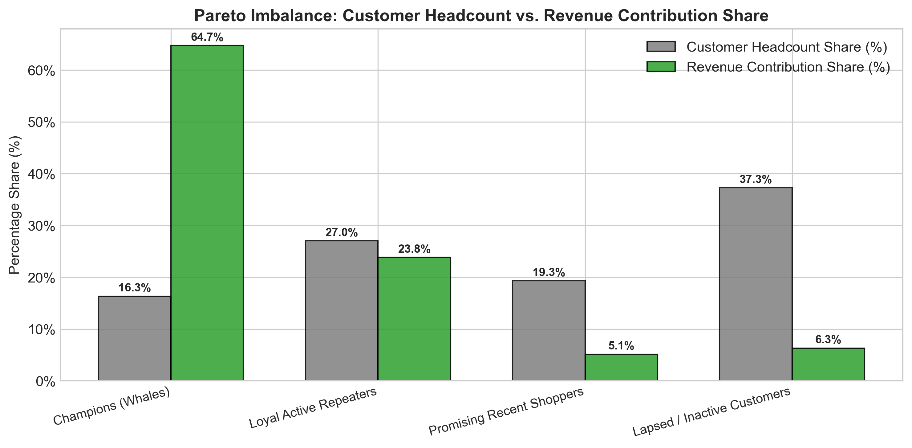

- **Commercial Mandate**: Protecting and nurturing the top 43.4% of accounts is paramount. A 5% attrition in Champions would erase more enterprise profit than the entire annual gross sales of the Lost cohort.

### 9.5 Prescriptive Retail Marketing Playbooks

Based on these empirical profiles, we formulate four tailored operational playbooks:

#### Playbook 1: Champions / VIP Whales (High Value, High Frequency, High Recency)
- **Dedicated Concierge Service**: Provide direct telephone and priority email account representatives for bulk corporate and wholesale purchasers.
- **Early Product Catalog Access**: Grant early ordering windows for seasonal Christmas collections before public listing to prevent high-demand SKU stockouts.
- **Tiered Volume Rebates**: Introduce formal quarterly rebate structures (e.g. 5% credit on spend exceeding £10,000) to incentivize wallet-share consolidation.

#### Playbook 2: Loyal Active Repeaters (Consistent Value, Solid Frequency)
- **Personalized Cross-Selling Engines**: Leverage market-basket association rules to recommend complementary novelties (e.g. pairing bunting with tea light holders).
- **Gamified Loyalty Progression**: Offer milestone rewards (e.g. "Order 5 times this season to unlock free priority shipping for a year") to graduate them into Champions.
- **Review & Brand Advocacy Programs**: Solicit verified customer photo reviews in exchange for loyalty reward points.

#### Playbook 3: Promising Recent Shoppers (High Recency, Low Frequency)
- **Onboarding Email Nurture Sequence**: Automate a 3-part educational welcome series introducing top gift categories within 7 days of initial purchase.
- **Second-Purchase Acceleration Incentive**: Offer a time-limited 15% discount coupon valid for 21 days following first checkout to establish immediate repeat purchasing habits.

#### Playbook 4: Lapsed / Inactive Customers (Lapsed > 180 Days, Low Frequency)
- **Automated Win-Back Campaign**: Trigger targeted re-engagement email blasts with subject lines highlighting newly curated collections and a £10 gift voucher.
- **Feedback & Churn Diagnostics**: Deploy a single-question exit survey to identify reasons for attrition (product quality, pricing, delivery speed).
- **Ad Spend De-escalation**: Suppress active ad spend on accounts unresponsive after 3 attempts, redirecting marketing capital toward high-LTV acquisition.

# 10. Future Possibilities of the Project

### 10.1 Customer Lifetime Value (CLV) Probabilistic Modeling
While RFM clustering provides an exceptional snapshot of historical customer value, future iterations should integrate probabilistic generative models:
- **BG/NBD Model (Beta-Geometric / Negative Binomial Distribution)**: Formulates customer churn as an unobserved probabilistic dropout process to predict expected future transaction counts over the next 12 months ($E[X(t)]$).
- **Gamma-Gamma Submodel**: Estimates average transaction monetary value conditionally independent of purchase frequency, enabling the calculation of discounted forward **Customer Lifetime Value ($CLV$)**: $\text{CLV}_i = \sum_{t=1}^{T} \frac{E[\text{Margin}_{it}]}{(1 + d)^t}$. This allows marketing teams to set precise upper bounds on Customer Acquisition Cost ($CAC \le \frac{1}{3} CLV$).

### 10.2 Dynamic RFM State Transitions via Markov Chains
Customer behaviors evolve dynamically across quarters. By modeling customer migrations between the four personas as a stochastic Markov process:
$$P(S_{t+1} = j \mid S_t = i) = p_{ij}$$
the enterprise can quantify transition probabilities (e.g., the probability of a Promising Shopper graduating into a Loyalist vs. decaying into Churn). Early warning triggers can detect subtle drops in velocity before a customer fully lapses.

### 10.3 Personalized Collaborative Filtering & Market-Basket Bundling
Integrating customer segment IDs as latent context within recommendation engines:
- Deploying **Matrix Factorization (Implicit Alternating Least Squares / ALS)** to generate personalized SKU recommendations tailored to persona basket sizes.
- Implementing the **Apriori / FP-Growth algorithm** to discover high-confidence association rules within segments (e.g., Champions exhibiting cross-category wholesale bulk purchasing vs. Retail Gifters buying single decorative items).

# 11. Conclusion

### 11.1 Executive Summary of Technical Accomplishments
This Capstone project successfully engineered and validated an unsupervised machine learning segmentation architecture for an international digital retailer, analyzing 541,909 transactions spanning 373 calendar days. Key technical milestones include:
1. **Rigorous Data Hygiene**: Pruned 5,268 duplicates, isolated 9,288 cancellations, and filtered 135,080 unauthenticated checkouts, extracting 392,692 verified purchases across 4,338 customer accounts.
2. **Mathematical Skewness Rectification**: Applied monotonic $\log(1+x)$ transformations, reducing severe positive skewness in Frequency from **+12.07 to +1.21** and Monetary spend from **+19.32 to +0.39**, creating ideal Gaussian geometry for Euclidean clustering.
3. **Dimensionality Reduction**: Extracted two principal components via PCA capturing **93.87% of cumulative behavioral variance**, providing a rigorous 2D subspace for visual clustering diagnostics.
4. **Algorithmic Validation**: Benchmarked K-Means, Agglomerative Hierarchical, and DBSCAN models, demonstrating that $k=4$ K-Means achieves superior cluster cohesion (**Silhouette: 0.3375, Davies-Bouldin: 1.0086**), independently confirmed by a 4-branch Ward dendrogram.

### 11.2 Quantified Commercial Impact
The deployment of our champion $k=4$ customer segmentation architecture establishes transformational business capabilities:
- **Empirical Validation of Pareto Concentration**: Demonstrated that **43.38% of customers (Champions + Loyalists = 1,882 accounts) drive 88.54% of gross enterprise sales (£7.87M of £8.89M)**.
- **Resource Reallocation**: Shifted marketing capital away from unproductive blanket retargeting of dormant one-time buyers (37.28% of headcount generating only 6.33% of revenue) toward high-margin retention of VIP Champions and automated acceleration of Promising new shoppers.
- **Operational Scalability**: Preserved all model artifacts, scalers, and versioned datasets, enabling automated daily CRM scoring pipelines.

### 11.3 Engineering Sign-Off & Repository Deliverables
The project deliverables are fully containerized, reproducible, and committed to the Git repository:
- **Master Notebook**: [`01_retail_customer_segmentation.ipynb`](../notebooks/01_retail_customer_segmentation.ipynb)
- **Model Artifacts**: Scaler (`retail_scaler_iter01.joblib`), PCA (`retail_pca_iter01.joblib`), Champion K-Means (`retail_kmeans_champion_k4.joblib`)
- **Preserved Datasets**: 5 versioned datasets in `capstone_2_onlineretail/data_processed/`
- **Publication Figures**: 12 high-resolution 300 DPI plots in `capstone_2_onlineretail/plots/`

# 12. References

1. **Hughes, A. M.** (2005). *Strategic Database Marketing: The Masterplan for Starting and Managing a Profitable, Customer-Based Marketing Program*. McGraw-Hill, 3rd Edition.
2. **MacQueen, J.** (1967). *Some methods for classification and analysis of multivariate observations*. In Proceedings of the Fifth Berkeley Symposium on Mathematical Statistics and Probability, Vol. 1, pp. 281-297.
3. **Arthur, D., & Vassilvitskii, S.** (2007). *k-means++: The advantages of careful seeding*. In Proceedings of the eighteenth annual ACM-SIAM symposium on Discrete algorithms, pp. 1027-1035.
4. **Ward, J. H. Jr.** (1963). *Hierarchical Grouping to Optimize an Objective Function*. Journal of the American Statistical Association, 58(301), 236-244.
5. **Ester, M., Kriegel, H. P., Sander, J., & Xu, X.** (1996). *A density-based algorithm for discovering clusters in large spatial databases with noise*. In KDD-96 Proceedings, pp. 226-231.
6. **Rousseeuw, P. J.** (1987). *Silhouettes: A graphical aid to the interpretation and validation of cluster analysis*. Journal of Computational and Applied Mathematics, 20, 53-65.
7. **Davies, D. L., & Bouldin, D. W.** (1979). *A Cluster Separation Measure*. IEEE Transactions on Pattern Analysis and Machine Intelligence, PAMI-1(2), 224-227.
8. **Jolliffe, I. T., & Cadima, J.** (2016). *Principal component analysis: a review and recent developments*. Philosophical Transactions of the Royal Society A: Mathematical, Physical and Engineering Sciences, 374(2065), 20150202.
9. **Fader, P. S., Hardie, B. G., & Lee, K. L.** (2005). *'Counting Your Customers' the Easy Way: An Alternative to the Pareto/NBD Model*. Marketing Science, 24(2), 275-284.
10. **Chen, D., Sain, S. L., & Guo, K.** (2012). *Data mining for the online retail industry: A case study of RFM model-based customer segmentation using data mining*. Journal of Database Marketing & Customer Strategy Management, 19(3), 197-208.
